# 云坞 CloudDock

一个面向 Android 的现代化 WebDAV 挂载器与文件系统。使用 Kotlin + Jetpack Compose 构建，面向 Android 14（API 34）验证，最低支持 Android 8.0（API 26）。

云坞把任意 WebDAV 空间变成可浏览、可缓存、可双向同步的文件工作区：多账户挂载、SAF 本地目录、文件管理、定时与事件触发的同步、内置文本/Markdown/代码/图片/音视频查看与编辑，以及手机/平板自适应界面。

## 功能

| 需求 | 实现 |
| --- | --- |
| 自定义添加多个 WebDAV | 完整表单：名称、URL、Basic 认证、允许自签名 TLS；可测试连接；账户信息卡显示服务端、缓存位置与同步状态 |
| 可收缩左侧栏 | 手机为滑出式侧栏，平板为常驻且可在 288dp / 84dp 之间折叠；显示账户、同步状态和挂载数量 |
| 每账户自定义本地缓存/下载目录 | 通过 Android SAF 选择并持久授权文件夹；也可使用应用私有目录；打开文件、下载、同步都使用该目录 |
| 基本文件系统功能 | 浏览、进入、新建文件/文件夹、重命名、编辑文本、删除、上传文件/文件夹、递归下载文件/文件夹、分享、查看详情、排序、搜索、列表/网格 |
| 不同文件类型图标 | 文件夹、文本、Markdown、代码、图片、音频、视频、PDF、办公文档、压缩包与通用文件均有独立图标与配色 |
| 按类型打开外部应用 | PDF、Office、压缩包等使用带临时读取授权的 `content://` URI 交给系统第三方应用；文本/图片/音视频默认使用内置查看器，也可从菜单选择“用其他应用打开” |
| 实时双向同步 | 打开挂载、文本保存、手动操作后以及可配置的 WorkManager 周期同步；按 ETag + 修改时间 + 大小基线与冲突检测选择最新版本 |
| 文本预览器 | 编码识别（UTF-8/UTF-16/GB18030）、只读阅读、内部编辑与保存；支持原始文本和 Markdown |
| Markdown 预览 | 标题、段落、粗体/斜体/删除线、行内代码、围栏代码、列表、引用、分割线、链接与表格 |
| 代码高亮 | 自研轻量词法高亮，覆盖 Kotlin/Java/JS/TS/Python/Go/Rust/C/C++/XML/JSON/YAML/CSS/SQL 等；带行号和复制 |
| 音频/视频播放器 | Media3 ExoPlayer：视频控制条；音频渐变封面、进度、前进/后退 10 秒、播放暂停；应用退到后台自动暂停 |
| 现代扁平风格 | Material 3、自定义主/辅色、浅色/深色/跟随系统、Android 12 动态取色、边到边、自适应列表/网格、平板常驻侧栏 |

其他必要能力：账户密码使用 Android Keystore AES-GCM 加密、持久 SAF 授权、错误提示与重试、文件缓存、下载/上传进度与取消、同步进度、所有账户手动同步、后台同步约束与执行记录、文件分享、外链打开、账户删除及任务清理。

## 界面

| 手机文件浏览 | 平板自适应布局 |
| --- | --- |
| 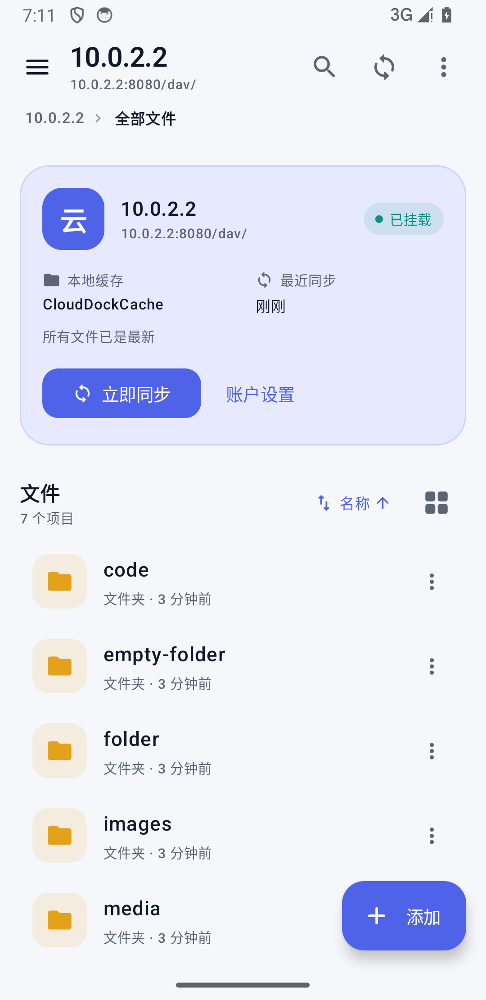 | 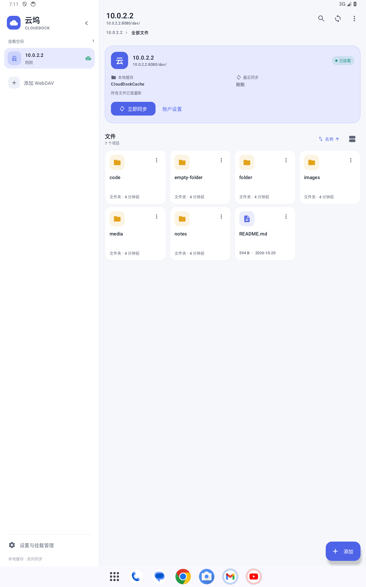 |

| 可收缩侧栏与多挂载 | 账户与 SAF 缓存设置 |
| --- | --- |
| 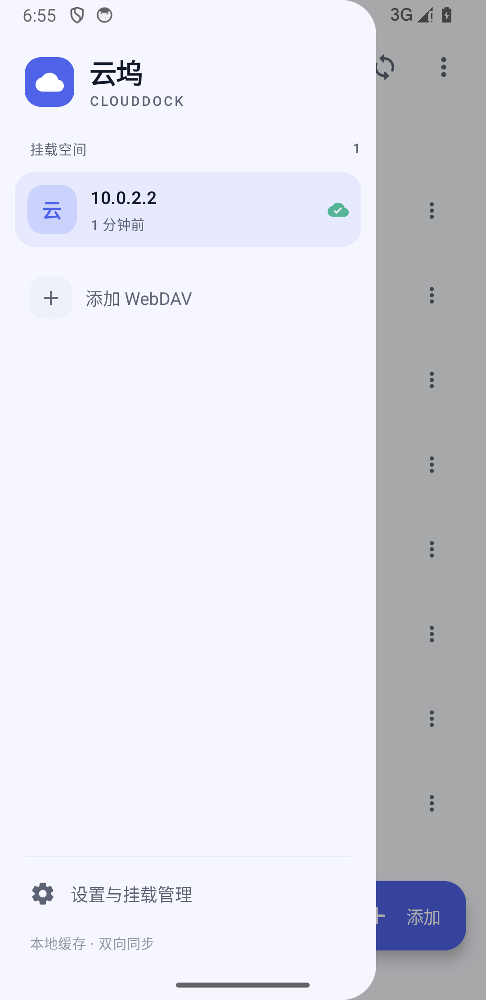 | 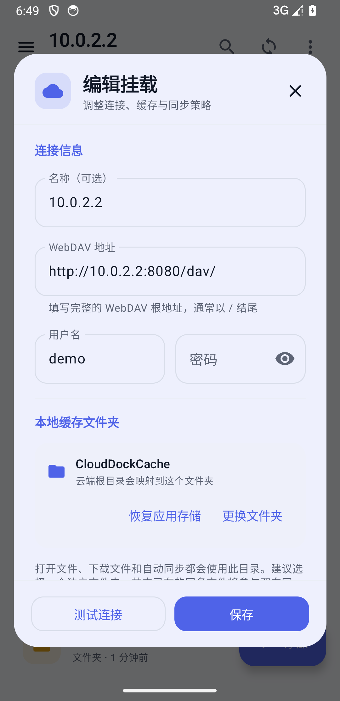 |

| Markdown 预览 | 代码高亮 |
| --- | --- |
| 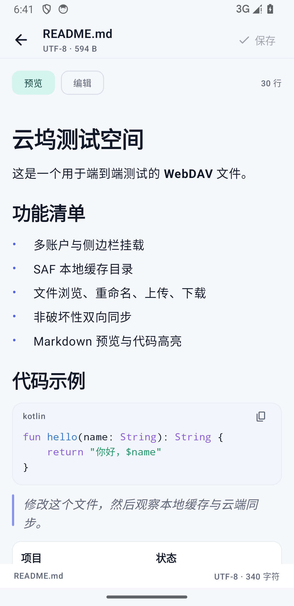 | 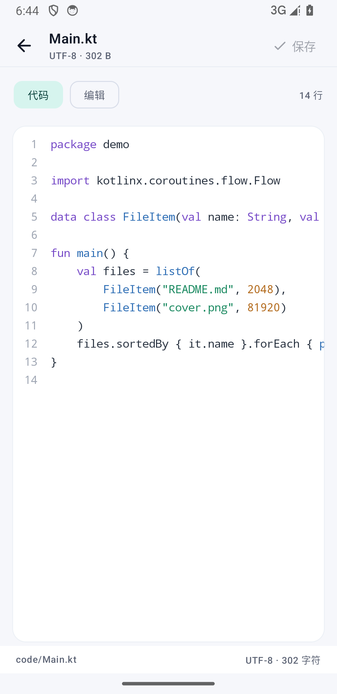 |

| 图片查看 | 音频播放 | 视频播放 |
| --- | --- | --- |
| 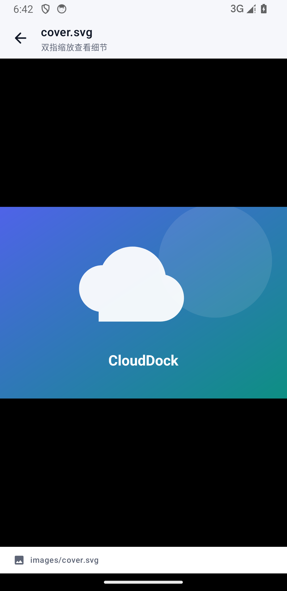 | 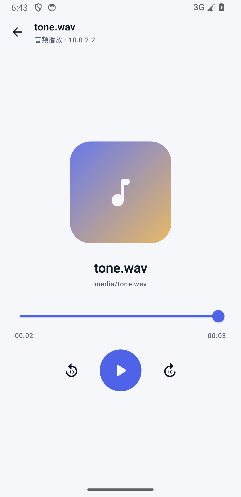 | 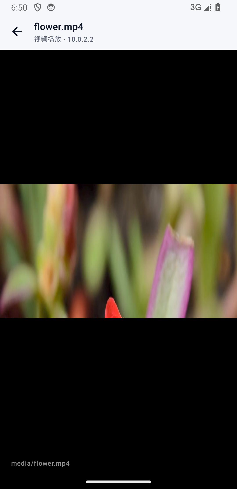 |

| 设置（浅色） | 设置（深色） | 首次使用 |
| --- | --- | --- |
| 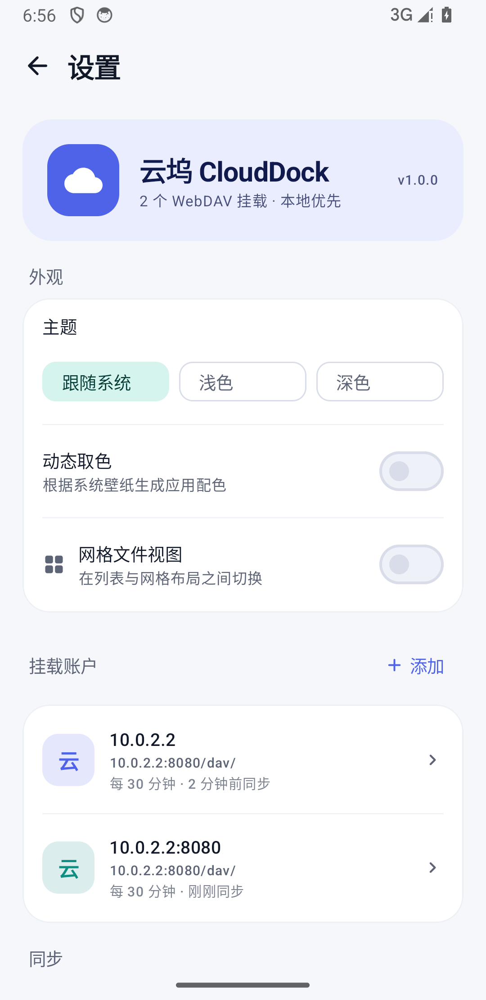 | 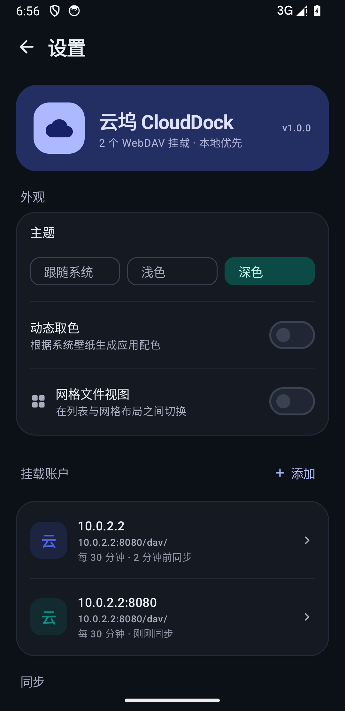 | 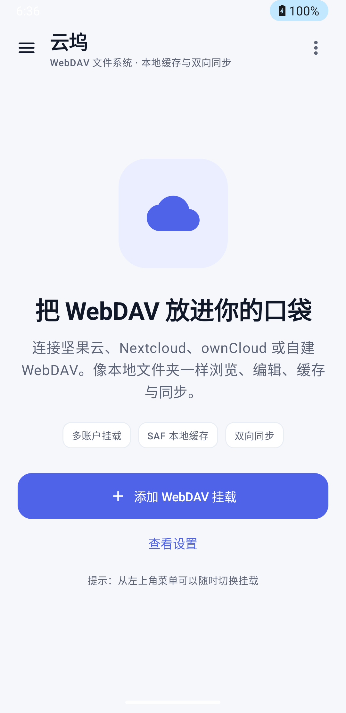 |

## 技术栈

- Kotlin 1.9.22，JVM target 17
- Jetpack Compose（BOM 2024.06.00）、Material 3、Navigation 由 Compose 状态机管理
- OkHttp 4.12 + Android `XmlPullParser`，自研 RFC 4918 WebDAV 客户端
- AndroidX DocumentFile + Storage Access Framework
- WorkManager 2.9（周期同步、网络约束）
- Media3 ExoPlayer 1.3.1（本地缓存媒体播放）
- Coil 2.6（图片/SVG）
- Android Keystore + AES/GCM
- Gradle 8.4、AGP 8.3.0、compileSdk/targetSdk 34、minSdk 26

## 架构

```text
app/src/main/java/com/clouddock/webdav/
├── MainActivity.kt
├── CloudDockApplication.kt        # AppContainer、Coil ImageLoader
├── data/
│   ├── AccountRepository.kt       # 账户 JSON + 加密凭据
│   ├── SettingsRepository.kt      # 主题/视图偏好
│   ├── model/Models.kt            # 账户、DAV 条目、同步摘要
│   ├── security/SecretCipher.kt   # Keystore AES-GCM
│   ├── remote/
│   │   ├── WebDavClient.kt        # PROPFIND/GET/PUT/MKCOL/DELETE/MOVE
│   │   ├── WebDavClientFactory.kt # Basic Auth、TLS、连接池
│   │   └── WebDavUrl.kt           # URL 与编码规范化
│   ├── local/
│   │   ├── CacheStore.kt          # SAF / 应用私有目录统一抽象
│   │   └── SafPermissions.kt      # 持久 URI 权限
│   └── sync/
│       ├── SyncEngine.kt          # 双向比较与传输
│       ├── SyncBaselineStore.kt   # ETag/mtime/size 基线
│       └── SyncWorker.kt          # WorkManager 周期任务
└── ui/
    ├── AppViewModel.kt            # 浏览、操作、同步、编辑状态
    ├── CloudDockApp.kt            # 自适应外壳、Snackbar、全局对话框
    ├── theme/                     # Material 3 主题
    ├── components/                # 侧栏、账户编辑器、文件项、Markdown
    ├── screens/                   # 浏览器、设置、文本、媒体、图片
    └── util/                      # 文件类型、路径、编码、语法高亮
```

### WebDAV 客户端

- `PROPFIND Depth: 0/1`，解析 `multistatus` 中的 displayname、resourcetype、getcontentlength、getlastmodified、getetag、getcontenttype。
- 目录 URL 统一补尾斜杠；路径逐段交由 `HttpUrl.Builder` 编码，正确处理空格、中文与特殊字符。
- Basic Auth 预先附加，支持 HTTP/HTTPS 与可选的“不校验证书”模式。
- 传输在 IO 线程执行，支持进度回调、协程取消与大文件流式读写。

### 本地缓存抽象

`CacheStore` 同时支持：

1. 用户通过 `ACTION_OPEN_DOCUMENT_TREE` 选择的 SAF 目录（持久读写授权）；
2. 未选择目录时的应用私有 `files/clouddock_cache/<accountId>`。

WebDAV 根目录与缓存根目录一一映射。写入文件采用临时文件/流式拷贝，避免打开时出现半截内容；文件 URI 通过 `content://` 传给外部应用、Coil 和 Media3。

### 同步策略

触发点：

- 打开挂载（账户启用“打开时同步”时）
- 文本编辑保存成功后
- 上传、重命名等操作完成后
- WorkManager 周期任务（0/15/30/60/180/720/1440 分钟）
- 用户点击同步

比较与合并：

- 每个文件的同步基线包含远端 ETag、远端修改时间、远端大小、本地修改时间、本地大小。
- 优先用 ETag 判断远端是否变化；SAF 文件以大小与修改时间判断本地变化。
- 仅一端变化：传输更新的一端。
- 两端都变化：选择修改时间较晚的一端，并计入冲突数。
- 仅在本地存在：上传；仅在远端存在：下载。
- **自动同步不会隐式删除任一端文件**；文件管理器内的显式删除会同时删除云端与本地副本。若要传播其他客户端的删除，需要在后续版本加入 tombstone。
- 同步互斥锁按账户串行；周期任务通过 WorkManager 唯一任务与网络约束执行。

### 安全

- WebDAV 密码不以明文写入 SharedPreferences；使用 Android Keystore 中的 AES-256-GCM 密钥加密，保存为 IV + 密文。
- 应用禁用了备份，避免账户数据随系统备份迁移。
- 允许自签名证书是逐账户、默认关闭的高级选项。
- 本地缓存通过 SAF 或私有目录访问，不申请广泛存储权限。
- 外部应用以临时 URI 读取授权访问缓存文件。

## 构建

要求：

- JDK 17（Android Studio 自带 JBR 即可）
- Android SDK Platform 34、Build-Tools 34.0.0
- 已配置 `local.properties` 的 `sdk.dir`

```bash
# Windows Git Bash / PowerShell 均可
./gradlew :app:assembleDebug
./gradlew :app:testDebugUnitTest
./gradlew :app:assembleRelease
```

产物：

- `app/build/outputs/apk/debug/app-debug.apk`
- `app/build/outputs/apk/release/app-release.apk`
- 构建后的可分发副本位于 `dist/`

Release 使用 `keystore/clouddock-release.jks` 进行本地签名（示例密钥，生产环境请替换）。若设备上已安装 Debug 版，需要先卸载再安装 Release 版，因为签名不同。

## 本地端到端测试

仓库内附带一个仅用于开发的 Zero-Dependency Node WebDAV 测试服务器：

```bash
node tools/webdav-test-server.js
```

- 地址（宿主机）：`http://127.0.0.1:8080/dav/`
- Android 模拟器：`http://10.0.2.2:8080/dav/`
- 用户名/密码：`demo` / `demo123`
- 首次启动会自动生成 Markdown、中文文本、代码、SVG、WAV 等测试文件。
- 支持 `PROPFIND/GET/HEAD/PUT/MKCOL/DELETE/MOVE` 和 Basic 认证。

已在 Pixel 3a Android 14（API 34）模拟器上实际验证：添加账户与连接测试、扫描/同步、SAF 目录授权与持久化、上传文件、递归下载文件夹、创建文件夹/文件、重命名、删除、文本编辑保存到云端、Markdown/代码/图片/音频/视频显示、多账户切换、WorkManager 周期任务强制执行、重启后 SAF 访问恢复。

单元测试：

```bash
./gradlew testDebugUnitTest
```

覆盖 URL 编码与 href 反解、路径规范化、UTF-8/GB18030 编码检测与格式化。

## 已知边界

- WebDAV 认证仅实现 Basic；Digest/OAuth 尚未支持。
- Markdown 为常用语法子集，不是完整 CommonMark。
- 自动同步不传播删除（见同步策略），两端修改冲突时采用时间较新的版本，不生成冲突副本。
- 更改账户缓存目录不会迁移旧目录中的文件；应用会使用新目录重新比对和同步。
- 后台周期同步受 Android 省电与电池优化限制，系统可能推迟执行。
- 媒体播放基于已缓存文件；不提供后台播放服务。

更多调研参考与设计取舍见 [docs/RESEARCH.md](docs/RESEARCH.md)。
